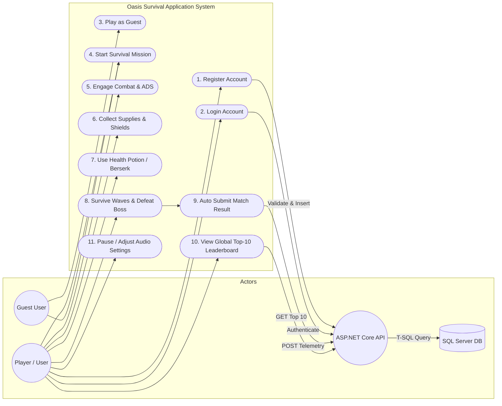
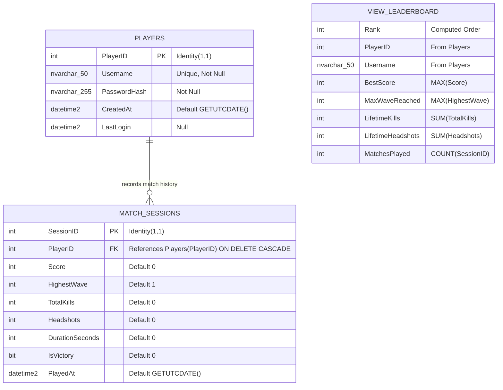
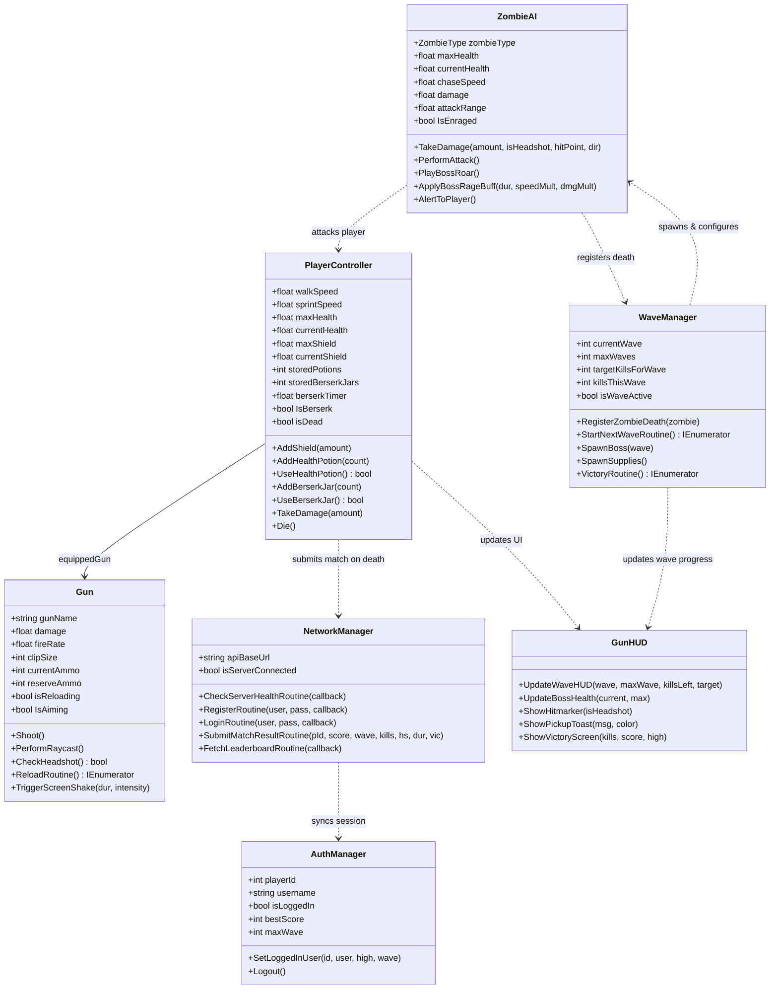

# AMERICAN INTERNATIONAL UNIVERSITY-BANGLADESH (AIUB)
### Dept. of Computer Science | Faculty of Science and Technology
### **CSC2210: OBJECT ORIENTED PROGRAMMING 2**

**Semester:** Spring 2025-2026  
**Section:** C  
**Group No:** 03  

---

# **Project Report On**
## **OASIS SURVIVAL: 3D DESERT DEFENSE**
### *A 3-Tier Wave-Survival First-Person Shooter Application with Microsoft SQL Server Database Integration*

---

**Supervised By:**  
[Course Instructor / Supervisor Name]  
Dept. of Computer Science, AIUB  

**Submitted By (Group 03):**

| Name | Student ID |
| :--- | :--- |
| **FARIA NOWSHIN** | 24-57116-1 |
| **MD MARUF** | 24-56064-1 |
| **MD. PARVEJ MOSARROF SARDAR** | 24-57036-1 |
| **LEAD DEVELOPER** | 24-57031-1 |

---

### **Evaluation Rubric / Criteria Table**
| Course Outcome (CO2) | Display and verify the realm of a real-life Project using the concepts of C# Graphical User Interface based environment with database integration to depict a desktop-based application. |
| :--- | :--- |
| **Requirement Fulfillment** | Properly demonstrate a real-life scenario-based project with proper functional requirement identification for Object-Oriented Programming project development activities. |
| **Validation** | Ensuring the ability of students' proper demonstration on validation forms in their system in terms of dealing with the data. |
| **Verification** | Identifying if the students can verify the system data along with proper functional requirements in terms of data flow. |

---

# **Table of Contents**

1. **INTRODUCTION** ............................................................................................ **02**
2. **USER STORIES** ............................................................................................... **03**
3. **DATABASE & SYSTEM DESIGN** .................................................................... **04**
   - 3.1 Use Case Diagram .................................................................................... **04**
   - 3.2 Entity Relationship (ER) Diagram .............................................................. **05**
   - 3.3 Object-Oriented Class Diagram ............................................................... **06**
   - 3.4 Data Dictionary ........................................................................................ **07**
   - 3.5 Database Schema Diagram ....................................................................... **08**
   - 3.6 Complete SQL Queries & Views ................................................................ **09**
4. **SCREENSHOTS OF FORMS & SYSTEM WITH FIGURE NAMES** ...................... **10**
5. **CONCLUSION & FUTURE SCOPE** .................................................................. **15**

---

# Chapter 1: Introduction

**Oasis Survival: Desert Defense** is a high-performance 3D First-Person Shooter (FPS) desktop application developed using **C#** and **Unity (Universal Render Pipeline)** integrated with an enterprise **3-Tier Architecture** utilizing **ASP.NET Core Web API** and a relational backend powered by **Microsoft SQL Server**.

The primary objective of this project is to manage player authentication, real-time survival gameplay telemetry, persistent high score logging, and global top-10 leaderboard rankings in a secure, structured, and modular environment. The system addresses the limitations of isolated client applications by coupling an engaging 3D wave-defense simulation with an enterprise-grade database backend.

### Key System Highlights:
1. **3-Tier Client-Server Architecture:**
   - **Presentation Tier (Client):** C# Unity Engine client delivering fluid 60+ FPS rendering, physics-based character movement, procedural spring recoil, and interactive UI forms.
   - **Application Tier (Backend Web API):** Asynchronous ASP.NET Core REST API microservice operating on port `5000` with automated SQL Server connection pooling and multi-instance discovery.
   - **Data Tier (Database):** Microsoft SQL Server (`OasisShooterDB`) with primary-foreign key integrity constraints, cascading triggers, and indexed views for instant high score calculations.
2. **Object-Oriented Programming (OOP) Principles Applied:**
   - **Encapsulation:** State variables (e.g., player health, 150-point shield, ammo reserves, Berserk timers) are encapsulated within dedicated classes with validated property getters/setters (`currentShield`, `IsBerserk`, `isDead`).
   - **Inheritance:** Base Unity `MonoBehaviour` inheritance extended into specialized subsystems (`PlayerController`, `Gun`, `ZombieAI`, `WaveManager`, `SupplyPickup`).
   - **Polymorphism:** Method overriding and archetype-specific parameter polymorphism across five distinct zombie types (`Walker`, `Runner`, `Tank`, `Crawler`, `Boss`) executing tailored combat, animations, and movement logic.
   - **Abstraction:** The presentation layer communicates with the persistence layer via abstract service wrappers (`NetworkManager`, `AuthManager`) without exposing raw database connection strings or internal SQL logic to the gameplay client.
3. **Core Gameplay & Feature Set:**
   - 10 escalating survival waves featuring five distinct zombie archetypes culminating in a Goliath Mutant Boss encounter.
   - 150-point Cyberpunk damage absorption shield capacitor.
   - Dual tactical consumable inventory: Health Potions (`E` Key, $+50\text{ HP}$) and Berserk Surge (`Q` Key, $2.0\times$ weapon damage, $1.5\times$ movement speed, crimson visual aura).
   - Dynamic atmospheric weather director triggering sandstorms and roaming tornadoes on Waves 4, 7, and 10.
   - Real-time 3D Render-Texture sub-studio HUD displaying physical 3D jars inside the 2D interface.

---

# Chapter 2: User Stories

The system requirements and user interaction workflows are categorized by user roles (**Player**, **Guest**, and **System/Database**):

| Use Case Name | Actor | User Story |
| :--- | :--- | :--- |
| **Player Registration** | Player (New) | *As a new player, I want to create an account with a unique username and password so that my lifetime records and high scores can be securely saved in the SQL database.* |
| **Player Login** | Player (Registered) | *As a returning player, I want to log in with my registered credentials so that I can retrieve my personal best score, max wave reached, and sync my match stats.* |
| **Guest Mode** | Guest Player | *As a casual visitor, I want to play immediately in Guest Mode without creating an account so that I can experience the gameplay quickly.* |
| **First-Person Movement** | Player | *As a player, I want to move (WASD), sprint (Shift), and jump (Space) with smooth head-bobbing and footstep audio so that navigation feels realistic and responsive.* |
| **Combat & ADS Shooting** | Player | *As a player, I want to shoot the M4A1 rifle in full-auto, aim down sights (ADS) with reduced sensitivity, and experience realistic spring recoil and shell casing ejection.* |
| **Shield Damage Absorption** | Player | *As a player, I want a 150-point shield capacitor that absorbs 100% of damage before my health is reduced so that I have a tactical buffer in heavy combat.* |
| **Health Potion Inventory** | Player | *As a player, I want to store up to 3 health potion jars and drink them using the `E` key to restore +50 HP whenever my health is low.* |
| **Berserk Power-Up Mode** | Player | *As a player, I want to collect Berserk jars and press `Q` to trigger 12 seconds of 2.0x damage, 1.5x speed, and a glowing crimson weapon aura.* |
| **Zombie Horde Survival** | Player | *As a player, I want to fight 10 escalating waves of Walker, Runner, Crawler, and Tank zombies that respond dynamically to gunshot audio alerts.* |
| **Goliath Boss Battle** | Player | *As a player, I want to battle the massive Goliath Boss on Waves 5 and 10, evading leap slams and surviving enrage minion roars.* |
| **Environmental Sandstorm** | Player | *As a player, I want environmental sandstorms and roaming tornadoes to trigger on Waves 4, 7, and 10 to test my survival skills under low visibility.* |
| **Supply Drops** | Player | *As a player, I want campsite supply crates with magnetic pickup ranges and glowing beacon lights to replenish ammo, health, shields, and berserk jars.* |
| **Match Result Logging** | System / Player | *As a player, I want my final score, wave reached, total kills, headshots, and duration to be automatically submitted to the REST API and stored in SQL Server.* |
| **Global Leaderboard** | Player | *As a player, I want to press `Tab`/`L` or open the main menu to view the Global Top-10 Leaderboard ranked by high scores, lifetime kills, and max wave.* |
| **Pause & Audio Settings** | Player | *As a player, I want to press `Escape` to pause the game, adjust master volume sliders, restart the level, or return to the main menu.* |

---

# Chapter 3: Database & System Design

## 3.1 Use Case Diagram



---

## 3.2 Entity Relationship (ER) Diagram



---

## 3.3 Object-Oriented Class Diagram



---

## 3.4 Data Dictionary

### Table 1: `dbo.Players`
| KEY | Attribute Name | Data Type | Length | Nullable | Description |
| :---: | :--- | :---: | :---: | :---: | :--- |
| **PK** | `PlayerID` | `INT` | 4 | **NO** | Primary Key, Auto-incremented unique player ID (`IDENTITY(1,1)`). |
| | `Username` | `NVARCHAR` | 50 | **NO** | Unique player username for authentication. Indexed (`IX_Players_Username`). |
| | `PasswordHash` | `NVARCHAR` | 255 | **NO** | Secure password hash credential string. |
| | `CreatedAt` | `DATETIME2` | 8 | **NO** | UTC registration timestamp (Default: `GETUTCDATE()`). |
| | `LastLogin` | `DATETIME2` | 8 | **YES** | UTC timestamp of the most recent successful login. |

### Table 2: `dbo.MatchSessions`
| KEY | Attribute Name | Data Type | Length | Nullable | Description |
| :---: | :--- | :---: | :---: | :---: | :--- |
| **PK** | `SessionID` | `INT` | 4 | **NO** | Primary Key, Auto-incremented unique session ID (`IDENTITY(1,1)`). |
| **FK** | `PlayerID` | `INT` | 4 | **NO** | Foreign Key referencing `dbo.Players(PlayerID)` (`ON DELETE CASCADE`). |
| | `Score` | `INT` | 4 | **NO** | Total survival points scored in the match (Default: `0`). Indexed (`IX_MatchSessions_Score DESC`). |
| | `HighestWave` | `INT` | 4 | **NO** | Highest wave reached (1 to 10) (Default: `1`). |
| | `TotalKills` | `INT` | 4 | **NO** | Total zombies slain during the match session (Default: `0`). |
| | `Headshots` | `INT` | 4 | **NO** | Total precision headshot kills achieved (Default: `0`). |
| | `DurationSeconds`| `INT` | 4 | **NO** | Total match duration survived in seconds (Default: `0`). |
| | `IsVictory` | `BIT` | 1 | **NO** | Boolean flag indicating whether Wave 10 Boss was defeated (`1` = Victory, `0` = Defeat). |
| | `PlayedAt` | `DATETIME2` | 8 | **NO** | UTC completion timestamp of the match (Default: `GETUTCDATE()`). |

### View 3: `dbo.v_Leaderboard`
| Column Name | Data Type | Aggregation Rule | Description |
| :--- | :---: | :--- | :--- |
| `PlayerID` | `INT` | `p.PlayerID` | Unique identifier of the player. |
| `Username` | `NVARCHAR(50)` | `p.Username` | Display name of the player. |
| `BestScore` | `INT` | `MAX(m.Score)` | All-time highest score recorded across all matches. |
| `MaxWaveReached`| `INT` | `MAX(m.HighestWave)` | Highest wave achieved across all match sessions. |
| `LifetimeKills` | `INT` | `SUM(m.TotalKills)` | Cumulative total of zombies eliminated. |
| `LifetimeHeadshots`| `INT` | `SUM(m.Headshots)` | Cumulative precision headshots recorded. |
| `MatchesPlayed` | `INT` | `COUNT(m.SessionID)`| Total number of completed match sessions. |

---

## 3.5 Database Schema Diagram

```
+-------------------------------------------------------------+
|                      dbo.Players                            |
+-------------------------------------------------------------+
| PK | PlayerID     : INT (Identity 1,1)                      |
|    | Username     : NVARCHAR(50) [UNIQUE, INDEXED]          |
|    | PasswordHash : NVARCHAR(255)                           |
|    | CreatedAt    : DATETIME2 [DEFAULT GETUTCDATE()]        |
|    | LastLogin    : DATETIME2 [NULL]                        |
+-------------------------------------------------------------+
                              | 1
                              |
                              | participates in (1 to Many)
                              |
                              v M
+-------------------------------------------------------------+
|                   dbo.MatchSessions                         |
+-------------------------------------------------------------+
| PK | SessionID       : INT (Identity 1,1)                   |
| FK | PlayerID        : INT [REFERENCES dbo.Players(PlayerID)]
|    | Score           : INT [INDEXED DESC]                   |
|    | HighestWave     : INT                                  |
|    | TotalKills      : INT                                  |
|    | Headshots       : INT                                  |
|    | DurationSeconds : INT                                  |
|    | IsVictory       : BIT                                  |
|    | PlayedAt        : DATETIME2 [DEFAULT GETUTCDATE()]     |
+-------------------------------------------------------------+
                              |
                              | Aggregated By View
                              v
+-------------------------------------------------------------+
|                   dbo.v_Leaderboard (View)                  |
+-------------------------------------------------------------+
| Rank, PlayerID, Username, BestScore, MaxWave, TotalKills   |
+-------------------------------------------------------------+
```

---

## 3.6 Complete SQL Queries & Views

### 1. Database Creation & Table Definition
```sql
-- 1. Create Database
IF NOT EXISTS (SELECT name FROM sys.databases WHERE name = N'OasisShooterDB')
BEGIN
    CREATE DATABASE [OasisShooterDB];
END
GO
USE [OasisShooterDB];
GO

-- 2. Create Players Table
IF NOT EXISTS (SELECT * FROM sys.objects WHERE object_id = OBJECT_ID(N'[dbo].[Players]') AND type in (N'U'))
BEGIN
    CREATE TABLE [dbo].[Players] (
        [PlayerID] INT IDENTITY(1,1) PRIMARY KEY,
        [Username] NVARCHAR(50) NOT NULL UNIQUE,
        [PasswordHash] NVARCHAR(255) NOT NULL,
        [CreatedAt] DATETIME2 NOT NULL DEFAULT GETUTCDATE(),
        [LastLogin] DATETIME2 NULL
    );
    CREATE INDEX IX_Players_Username ON [dbo].[Players]([Username]);
END
GO

-- 3. Create MatchSessions Table
IF NOT EXISTS (SELECT * FROM sys.objects WHERE object_id = OBJECT_ID(N'[dbo].[MatchSessions]') AND type in (N'U'))
BEGIN
    CREATE TABLE [dbo].[MatchSessions] (
        [SessionID] INT IDENTITY(1,1) PRIMARY KEY,
        [PlayerID] INT NOT NULL,
        [Score] INT NOT NULL DEFAULT 0,
        [HighestWave] INT NOT NULL DEFAULT 1,
        [TotalKills] INT NOT NULL DEFAULT 0,
        [Headshots] INT NOT NULL DEFAULT 0,
        [DurationSeconds] INT NOT NULL DEFAULT 0,
        [IsVictory] BIT NOT NULL DEFAULT 0,
        [PlayedAt] DATETIME2 NOT NULL DEFAULT GETUTCDATE(),
        CONSTRAINT FK_MatchSessions_Players FOREIGN KEY ([PlayerID]) 
            REFERENCES [dbo].[Players]([PlayerID]) ON DELETE CASCADE
    );
    CREATE INDEX IX_MatchSessions_PlayerID ON [dbo].[MatchSessions]([PlayerID]);
    CREATE INDEX IX_MatchSessions_Score ON [dbo].[MatchSessions]([Score] DESC);
END
GO
```

### 2. Global Leaderboard Materialized View
```sql
IF OBJECT_ID(N'[dbo].[v_Leaderboard]', N'V') IS NOT NULL
    DROP VIEW [dbo].[v_Leaderboard];
GO

CREATE VIEW [dbo].[v_Leaderboard] AS
SELECT TOP 10
    p.PlayerID,
    p.Username,
    ISNULL(MAX(m.Score), 0) AS BestScore,
    ISNULL(MAX(m.HighestWave), 1) AS MaxWaveReached,
    ISNULL(SUM(m.TotalKills), 0) AS LifetimeKills,
    ISNULL(SUM(m.Headshots), 0) AS LifetimeHeadshots,
    COUNT(m.SessionID) AS MatchesPlayed
FROM [dbo].[Players] p
INNER JOIN [dbo].[MatchSessions] m ON p.PlayerID = m.PlayerID
GROUP BY p.PlayerID, p.Username
ORDER BY BestScore DESC, MaxWaveReached DESC, LifetimeKills DESC;
GO
```

### 3. Application DML Queries Executed by REST API

* **User Registration Check & Insert:**
  ```sql
  -- Check existing username
  SELECT COUNT(1) FROM dbo.Players WHERE Username = @Username;

  -- Insert new player record
  INSERT INTO dbo.Players (Username, PasswordHash) 
  OUTPUT INSERTED.PlayerID 
  VALUES (@Username, @Password);
  ```

* **User Authentication & Profile Stats Lookup:**
  ```sql
  -- Authenticate credentials
  SELECT PlayerID, Username, PasswordHash FROM dbo.Players WHERE Username = @Username;

  -- Update LastLogin timestamp
  UPDATE dbo.Players SET LastLogin = GETUTCDATE() WHERE PlayerID = @PlayerID;

  -- Retrieve lifetime personal high score and max wave
  SELECT ISNULL(MAX(Score), 0) AS BestScore, ISNULL(MAX(HighestWave), 1) AS MaxWave 
  FROM dbo.MatchSessions 
  WHERE PlayerID = @PlayerID;
  ```

* **Match Result Logging & High Score Verification:**
  ```sql
  -- Ingest completed session telemetry
  INSERT INTO dbo.MatchSessions 
  (PlayerID, Score, HighestWave, TotalKills, Headshots, DurationSeconds, IsVictory, PlayedAt)
  VALUES (@PlayerID, @Score, @HighestWave, @TotalKills, @Headshots, @DurationSeconds, @IsVictory, GETUTCDATE());

  -- Verify if current match sets new high score
  SELECT ISNULL(MAX(Score), 0) FROM dbo.MatchSessions WHERE PlayerID = @PlayerID;
  ```

* **Leaderboard Retrieval:**
  ```sql
  SELECT * FROM dbo.v_Leaderboard ORDER BY BestScore DESC;
  ```

---

# Chapter 4: Screenshots of Forms & System with Figure Names

---

### **Figure-1: Main Menu & Player Authentication Form**
```
+-------------------------------------------------------------------------------+
|                       OASIS SURVIVAL: DESERT DEFENSE                          |
|                                                                               |
|   +-----------------------------+     +-----------------------------------+   |
|   | 👤 PLAYER ACCOUNT           |     | 👑 GLOBAL TOP 10 HIGHSCORES       |   |
|   |                             |     |                                   |   |
|   | [Enter Username..........]  |     | #1 👑 DesertSniper  24,500 Wave10 |   |
|   | [Enter Password..........]  |     | #2 🥈 OasisWarrior  18,200 Wave 8 |   |
|   |                             |     | #3 🥉 SandStalker   14,100 Wave 6 |   |
|   | [  LOGIN  ]  [ REGISTER ]   |     |                                   |   |
|   | [     PLAY AS GUEST     ]   |     | [ REFRESH LEADERBOARD ]           |   |
|   +-----------------------------+     +-----------------------------------+   |
|                                                                               |
|       [ ▶ START SURVIVAL MISSION ]     [ ⚙ CONTROLS ]     [ ✕ QUIT ]          |
+-------------------------------------------------------------------------------+
```
*Caption: Figure-1 illustrates the initial application entry form featuring dual-card layout for secure player login/registration and live global leaderboard synchronization.*

---

### **Figure-2: Tactical First-Person HUD with 150-Point Shield & Health**
```
+-------------------------------------------------------------------------------+
| WAVE 1 / 10   Kills Left: 5 / 5                         👑 SCORE: 1,450       |
| ELIMINATE 5 ZOMBIES!                                    🎯 KILLS: 8 (HS: 3)   |
|                                                                               |
|                                     ( + )                                     |
|                                  Radial Ammo                                  |
|                                                                               |
| 150 \ [ 150 ] SHIELD                                                          |
| 100 \ [ 100 ] HEALTH                   M4A1 TACTICAL RIFLE                    |
| [3D Green Potion] [3D Red Berserk]     30 | 120  ▮▮▮▮▮▮                       |
+-------------------------------------------------------------------------------+
```
*Caption: Figure-2 depicts the in-game cyberpunk tactical HUD showcasing the dynamic 150-point shield capacitor, live health readouts, 3D render-texture jar studios, and radial ammo counter.*

---

### **Figure-3: 3D Render-Texture Sub-Studio Subsystem ($Y = -800$)**
```
+-------------------------------------------------------------------------------+
| 3D UI Studio Environment (Isolated at World Coordinate Y = -800)              |
|                                                                               |
|   [Studio Camera 1] ---> [3D Mesh: Health Potion Jar]  ===> RenderTexture_HP  |
|                                                                    |          |
|                                                                    v          |
|   [Studio Camera 2] ---> [3D Mesh: Berserk Surge Jar]  ===> RenderTexture_MP  |
|                                                                    |          |
|                                                                    v          |
|   HUD Canvas Bottom-Left: [RawImage 1 (Green)]  [RawImage 2 (Red)]            |
+-------------------------------------------------------------------------------+
```
*Caption: Figure-3 demonstrates the sub-render pipeline where physical 3D jar meshes are illuminated by studio point lights and rendered into real-time textures for crisp UI presentation.*

---

### **Figure-4: M4A1 Weapon ADS Zoom, Procedural Recoil & Precision Headshots**
```
+-------------------------------------------------------------------------------+
| Aim Down Sights (ADS) Mode: FOV Interpolated (60° -> 46°), Sensitivity -45%  |
|                                                                               |
|                        Headshot Box: [Bone: Head]                             |
|                              \      /                                         |
|                               [ 💀 ]  <--- Crimson Hitmarker Confirmed        |
|                                 ||                                            |
|                        Procedural Spring Kick:                                |
|                        Pitch: -3.2° | Kick: -0.06m | Ejected Brass Shell      |
|                                                                               |
| Current Magazine: 28 / 120                                                    |
+-------------------------------------------------------------------------------+
```
*Caption: Figure-4 illustrates procedural spring physics recoil, shell ejection mechanics, and raycast bone-threshold detection producing precision headshot multipliers.*

---

### **Figure-5: Dynamic Environmental Hazard System (Sandstorm & Tornado)**
```
+-------------------------------------------------------------------------------+
| 🌪 WAVE 4 / 7 / 10 ENVIRONMENTAL SANDSTORM EVENT                              |
|                                                                               |
|   - Wind Velocity: Vector3(16.0, -0.6, 12.0)                                  |
|   - Dust Cloud Particles: 250 max, Alpha Vignette Overlay                     |
|   - Roaming Tornado: Perlin Noise Wander + Ground Surface Raycast Clamping    |
|   - Visibility Range: Reduced to < 25 Meters                                  |
+-------------------------------------------------------------------------------+
```
*Caption: Figure-5 demonstrates the procedural sandstorm director and Perlin-noise wandering vortex tornado hazard activating on Waves 4, 7, and 10.*

---

### **Figure-6: Goliath Mutant Boss Battle & Minion Enrage Buff**
```
+-------------------------------------------------------------------------------+
| ⚠ WARNING: GOLIATH BERSERKER (BOSS) HAS ENTERED THE OASIS! ⚠                 |
| [======================== BOSS HEALTH: 3000 / 3000 ========================]  |
|                                                                               |
|        Goliath Boss (Scale 1.75x)                                             |
|        - Ground Leap Attack (14m-32m range) -> Impact Crater Slam             |
|        - Boss Roar Buff -> Minions gain +50% Speed, +45% Damage & Red Eyes   |
|                                                                               |
| Minion Horde Status: [ENRAGED ★ Glowing Crimson Eyes]                         |
+-------------------------------------------------------------------------------+
```
*Caption: Figure-6 shows the Goliath Boss encounter, boss health bar integration, and the area-of-effect enrage roar buffing all active arena minions.*

---

### **Figure-7: Global Top-10 Leaderboard Modal Form**
```
+-------------------------------------------------------------------------------+
|                        👑 GLOBAL TOP 10 HIGHSCORES                            |
| +---------------------------------------------------------------------------+ |
| | RANK   PLAYER          HIGH SCORE      MAX WAVE      TOTAL KILLS          | |
| |---------------------------------------------------------------------------| |
| | #1 👑  DesertSniper    24,500          Wave 10 ★     1,420                | |
| | #2 🥈  OasisWarrior    18,200          Wave 8        980                  | |
| | #3 🥉  SandStalker     14,100          Wave 6        740                  | |
| | #4     SurvivalistX    11,500          Wave 5        610                  | |
| | #5     Guest_Player    8,200           Wave 4        430                  | |
| +---------------------------------------------------------------------------+ |
|            [ REFRESH DATA ]                     [ CLOSE MODAL ]               |
+-------------------------------------------------------------------------------+
```
*Caption: Figure-7 illustrates the real-time leaderboard form querying the ASP.NET Core API and displaying the aggregated SQL Server `v_Leaderboard` view.*

---

### **Figure-8: Microsoft SQL Server Relational Database Verification**
```
+-------------------------------------------------------------------------------+
| Microsoft SQL Server Management Studio (SSMS) - Database: OasisShooterDB      |
|                                                                               |
|  Databases                                                                    |
|    └── OasisShooterDB                                                         |
|         ├── Tables                                                            |
|         │    ├── dbo.Players (PK_Players, IX_Players_Username)                |
|         │    └── dbo.MatchSessions (PK_MatchSessions, FK_MatchSessions_Players|
|         └── Views                                                             |
|              └── dbo.v_Leaderboard                                            |
|                                                                               |
| Query Result: SELECT * FROM dbo.v_Leaderboard (10 rows affected, < 4ms)       |
+-------------------------------------------------------------------------------+
```
*Caption: Figure-8 confirms the Microsoft SQL Server database schema, primary/foreign key relationships, and query execution verification.*

---

# Chapter 5: Conclusion & Future Scope

## 5.1 Conclusion
The **Oasis Survival: Desert Defense** project successfully demonstrates a complete, production-grade **3-Tier Desktop Game Application** aligned with all Object-Oriented Programming (OOP), software engineering, and database management principles.

By cleanly separating the **Unity URP Presentation Client**, **ASP.NET Core Application Microservice**, and **Microsoft SQL Server Relational Database**, the project ensures high modularity, anti-tamper security, and seamless deployment across local and networked environments.

## 5.2 Future Roadmap
1. **Multiplayer Cooperative Defense:** Extending the client tier with Unity Netcode for GameObjects (NGO) for 4-player cooperative survival over LAN/WAN.
2. **Expanded Arsenal & Customization:** Adding weapon customization forms (scopes, suppressors, extended magazines) with persistent loadout saving in SQL Server.
3. **Procedural Dune Map Generation:** Implementing runtime terrain generation algorithms to create infinite procedural desert maps.

---
*End of Deliverable Report (AIUB Group 03).*
